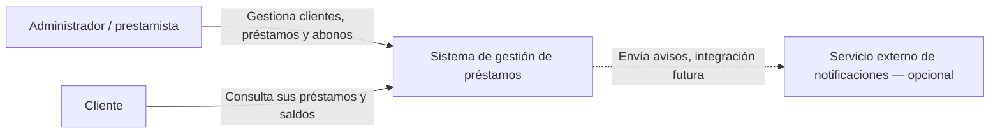
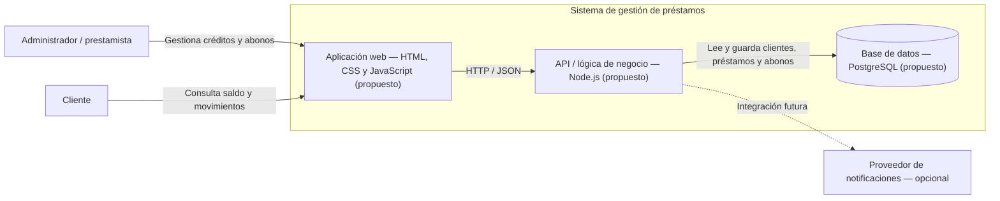

# Práctica 6 — Diagramas C4 del sistema de préstamos

**Curso:** Ingeniería de Software II
**Proyecto:** Sistema de gestión de préstamos, intereses y abonos.
**Estado:** Arquitectura propuesta para el proyecto descrito; no implica que los contenedores estén implementados.

## Nivel 1 (C1): Contexto del sistema

El sistema permite al prestamista administrar créditos y pagos, y a los clientes consultar su información. Un proveedor de notificaciones se representa como posible integración externa.

**Justificación de decisiones y atributos de calidad (5 líneas):**

1. **Decisión 1:** separo al administrador del cliente porque sus actividades y permisos son distintos.
2. Priorizo **seguridad y confidencialidad**: los clientes deben acceder solamente a sus propios datos, aunque el control de permisos requiere más esfuerzo de desarrollo.
3. **Decisión 2:** muestro las notificaciones como integración externa opcional y no como parte indispensable del núcleo.
4. Priorizo **modificabilidad y mantenibilidad**: será posible cambiar el proveedor de avisos sin alterar el objetivo del sistema.
5. El costo del desacoplamiento es **complejidad de integración y dependencia de un proveedor externo**; por eso se plantea como funcionalidad futura.

## Nivel 2 (C2): Contenedores del sistema

Esta vista descompone **solo** el sistema de préstamos del C1. Los nombres de tecnología que aparecen son **propuestas**, no implementaciones confirmadas.

**Justificación de decisiones y atributos de calidad (5 líneas):**

1. **Decisión 1:** separo la interfaz web de la API donde se ejecutarían las reglas de interés, préstamos y abonos.
2. Priorizo **testabilidad y mantenibilidad**: el cálculo de intereses puede verificarse sin levantar pantallas, a cambio de mayor complejidad inicial.
3. **Decisión 2:** propongo una base de datos relacional separada para preservar clientes, créditos y movimientos.
4. Priorizo **integridad, confiabilidad y consistencia** de saldos y abonos; las operaciones monetarias exigen validaciones y transacciones.
5. El trade-off es **costo operativo y latencia** adicional por la comunicación entre contenedores; la arquitectura podría simplificarse si el alcance final es pequeño.

## Correcciones al borrador elaborado con apoyo de IA

- Reemplacé afirmaciones de tecnologías ya desplegadas por **tecnologías propuestas**: no se ha verificado aquí que el proyecto use Node.js o PostgreSQL.
- Evité agregar microservicios, cobro automático o aplicaciones móviles que no están confirmados en el alcance.
- La integración con notificaciones aparece como **opcional**, no como dependencia obligatoria.
- Separé actores y sistema en C1; en C2 representé contenedores internos y sus relaciones.
- Los atributos de calidad y las desventajas se vinculan a cada decisión en vez de asumir que una arquitectura es mejor en todos los casos.

## Verificación

- [x] Diagrama Mermaid de contexto C1.
- [x] Diagrama Mermaid de contenedores C2 con tecnologías propuestas.
- [x] Cinco líneas de justificación debajo de cada diagrama, con dos decisiones y atributos de calidad.
- [x] Nota con correcciones al contenido asistido por IA.
- [ ] Confirmar visualmente que GitHub muestra ambos diagramas renderizados.
- [ ] Confirmar stack real con el cliente/equipo antes de implementar.
